<h1 align="center">
  
</h1>

## About Me

I'm a third-year undergraduate at **Hunan University**. I study **RSI algorithms** and build **agent frameworks for robots**. **Python** is my main language for prototyping, running experiments, and building tools.

## Research & Engineering

### RSI algorithms

I'm interested in how an agent can use feedback from previous runs to improve its behavior. I prototype algorithms in Python and use experiments to explore which changes lead to consistent gains across tasks.

### Robot agent frameworks

I work on the software that connects an agent's decisions to the actions a robot can take. I'm especially interested in how agents break down tasks, call robot skills, and use execution feedback to decide what to do next.

## 🧰 Tech Stack | 技术栈

| Area | Tools & methods |
| --- | --- |
| **Agent systems** | Deep Agents (`deepagents`), LangGraph, ROS |
| **Retrieval & evaluation** | RAG, RSI algorithms and evaluation |
| **Development & deployment** | Python, FastAPI, Docker |

## 🧭 Learning Focus | 学习方向

1. **RSI 评测 · RSI Evaluation** — Define benchmarks and compare how consistently agents improve across runs.
2. **多 Agent 框架 · Multi-Agent Frameworks** — Explore how planners, workers, and reviewers coordinate on multi-step tasks.
3. **ROS 机器人 LLM 代理 · LLM Agents for ROS Robots** — Connect LLM task plans to ROS robot skills and use execution feedback to guide the next action.

## Selected Repositories

- [instant_ws](https://github.com/RePlasmid/instant_ws) — A ROS workspace for bringing up a mobile robot and running its navigation workflow.
- [OpenChatBI Semantic](https://github.com/RePlasmid/openchatbi-semantic) — A Python data analysis workbench built on OpenChatBI. It turns natural-language questions into SQL and exposes the query plan and results for inspection.

## Contact

[3590105938@qq.com](mailto:3590105938@qq.com)

  

